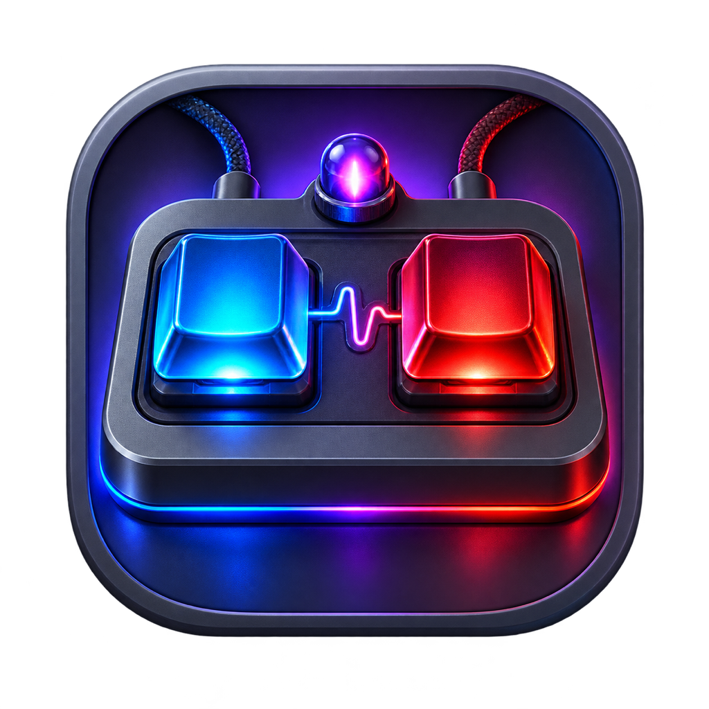

# Keyboard Studio

[](https://github.com/aranlucas/keyboard-studio/actions/workflows/ci.yml)
[](LICENSE)

Keyboard Studio is a native macOS SwiftUI configurator and Codex status deck for the SayoDevice O2L V2. Plug in the pad, stage a layer of shortcuts and macros, add a Codex Deck, and save only when the configuration looks right. The app reads the device over macOS IOKit HID and keeps edits reviewable before writing them.

<p></p>

The app is intentionally hardware-specific. The current HID bridge matches the SayoDevice O2L V2 vendor interface; it is not a general-purpose keyboard remapper.

## What it provides

- Read and edit button layers, key modes, modifiers, media actions, text/password macros, and lighting.
- Back up and restore device configuration, with protocol checks before a flash commit.
- Configure Hyperdeck gesture profiles and hot keys.
- Install a Codex Deck on Layer 1, map F13/F16 triggers, and show Codex work or attention status through the pad and menu bar.
- Review recent Codex activity and open Codex from the app or the menu bar.
- Run `sayo-probe` for device inspection and `protocol-check` for read-only protocol, backup, lighting, Codex Deck, and gesture assertions.

Device scripts are stored on the keyboard. Keyboard Studio does not execute shell scripts from the device. Input Monitoring is used only to connect to and configure the SayoDevice; the app registers dedicated F13/F16 hot keys rather than inspecting arbitrary keystrokes.

## Requirements

- macOS 14 or later.
- Swift 6 (the package declares `swift-tools-version: 6.0`).
- A connected SayoDevice O2L V2 for device features. The command-line protocol checks that do not require a device can still validate the model and configuration logic.
- macOS Input Monitoring permission when the HID bridge asks for it.

There is no checked-in Xcode project. The Swift Package Manager manifest is the build entry point; opening the package in Xcode is optional.

## Build and run

```bash
swift build
swift test
swift run KeyboardStudio
```

These invocations inspect the device or check the model without writing configuration:

```bash
swift run sayo-probe
swift run protocol-check
```

`sayo-probe --install-codex-deck` writes and commits button mappings; its
`--set-static-lighting-v2` and `--set-lighting-v2-raw` options change volatile
lighting. These are explicit hardware actions, not offline checks.

To make a local, ad-hoc-signed `.app` bundle on a supported Mac:

```bash
scripts/package_app.sh
```

The script writes `dist/Keyboard Studio.app`, builds the host architecture, and signs it ad hoc. It is a local development package, not a notarized public distribution.

## Save, backup and recovery

Edits stay staged until you use the relevant page's Save button. Before flash,
the configuration actor validates the complete plan and expected device identity,
verifies writes, and restores temporary status lighting. It reapplies the status
lamp after flash succeeds; lamp failure is reported separately from save success.

- Export a starting configuration from **Backup & Restore** before editing.
  Export captures the currently staged values, so do this before making changes
  if you need the original configuration. Password slots are excluded unless
  loaded and explicitly included; keep backups containing secrets private.
- Import requires a connected keyboard and validates its identity and
  capabilities. Import only stages values; review each page before saving.
- After an incomplete save, volatile settings may have changed. Refresh and
  review the device before retrying; there is no promised firmware rollback.
  If the flash acknowledgement failed, persistence is uncertain too.
- To grant device access, click **Open Input Monitoring**, enable Keyboard Studio
  in System Settings, then quit and reopen the app. Closing the window leaves
  the menu-bar process running; use Quit or the packaged app's Restart control.
  See [permission identity recovery](work/keyboard-two/report/reverse-engineering.md#permission-identity-and-recovery)
  for a stale grant after rebuilding.

Firmware update, bootloader/recovery, device lock and factory reset are guarded
maintenance capabilities, not implemented raw commands. They require verified
model-specific semantics or firmware, a recoverable backup and explicit user
confirmation before they can be enabled.

## Validation and protocol reference

Offline core tests and `protocol-check` also run on Linux with Swift 6. The Linux package excludes the SwiftUI app and live HID tools and uses a non-hardware default transport. Configuration regression tests inject a scripted transport on both platforms:

```bash
swift test -j 2
swift run -c release protocol-check
```

The repository CI runs whitespace/package-graph checks, `swift test`, a release build, `protocol-check`, and a Clang static analysis pass over the HID bridge. A physical keyboard is required to exercise live HID discovery and flash writes.

The [hardware protocol notes](work/keyboard-two/report/reverse-engineering.md)
retain observed firmware quirks and the reasons for preserving opaque bytes.
See the [proposed roadmap](ROADMAP.md) for ordered product priorities and release
acceptance criteria.

## License

See [`LICENSE`](LICENSE) and [`NOTICE`](NOTICE).
